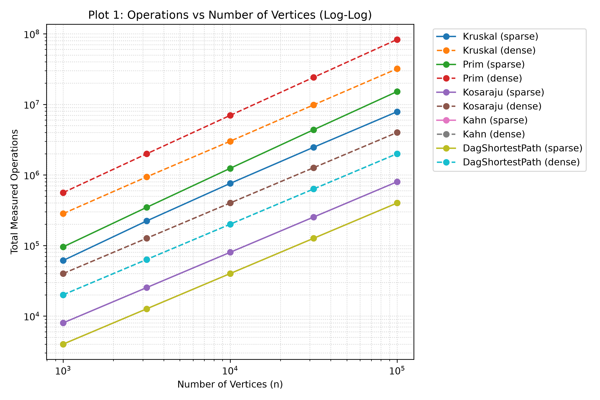
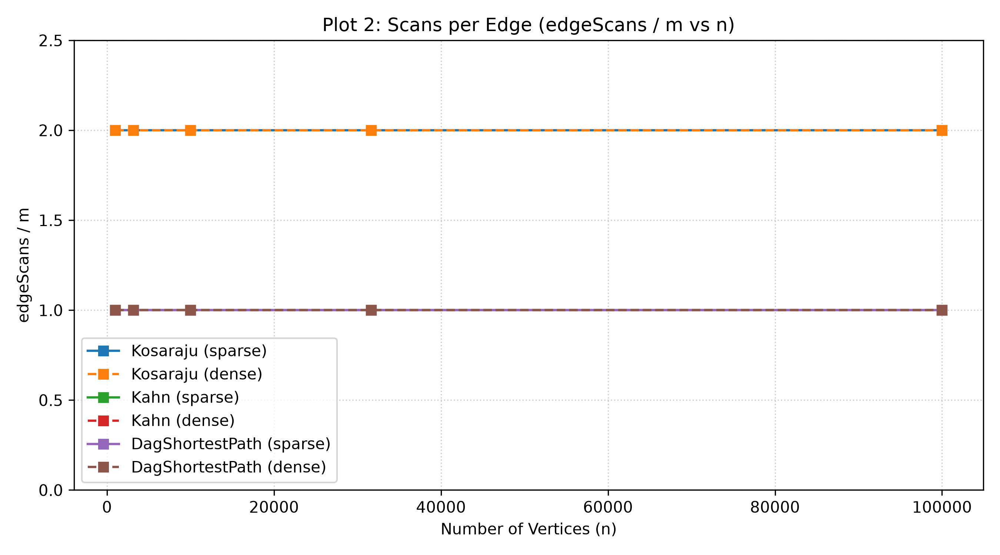
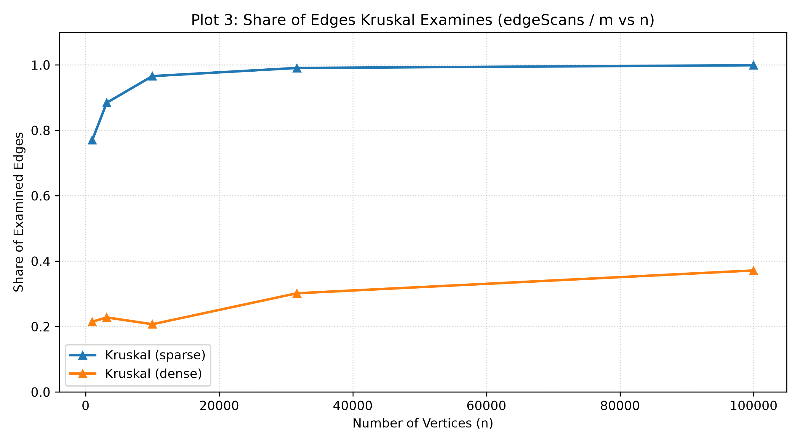

# Assignment 3: Graphs - Complexity and Performance Report
**Author:** Нұрсаят Башан

**Github repo** https://github.com/NursayatBshn/DAA_Assignment3_Project.git

## 1. Complexity Table

| Algorithm | Time Complexity | Extra Space | Justification |
| :--- | :--- | :--- | :--- |
| **DSU (Find/Union)** | $O(\alpha(V))$ | $O(V)$ | Union by rank keeps trees shallow, and path compression flattens them, giving nearly $O(1)$ amortized time per operation. Arrays `parent` and `rank` take $O(V)$ space. |
| **Kruskal's MST** | $O(E \log E)$ | $O(V + E)$ | Sorting $E$ edges takes $O(E \log E)$. Iterating through edges and performing DSU operations takes $O(E \cdot \alpha(V))$. The sorting step dominates the time complexity. |
| **Prim's MST** | $O(E \log V)$ | $O(V + E)$ | Each of the $V$ vertices is extracted from the PriorityQueue in $O(\log V)$, and each of the $E$ edges may be added to the PQ, leading to $O(E \log V)$ time. |
| **Kosaraju's SCC** | $O(V + E)$ | $O(V + E)$ | The algorithm performs exactly two DFS passes. The first pass on $G$ scans $E$ edges, and the second pass on $G^T$ scans $E$ edges, resulting in strictly $2E$ scans. |
| **Kahn's Topological Sort** | $O(V + E)$ | $O(V)$ | Computes in-degrees in $O(E)$ and processes each vertex and its outgoing edges exactly once using a queue, giving $O(V+E)$ time. |
| **DAG Shortest Paths** | $O(V + E)$ | $O(V)$ | Relaxes the outgoing edges of each vertex exactly once in topological order. Since vertices are processed once and edges are scanned once, time is $O(V+E)$. |

## 2. Counters vs Formulas & Slope Check

The empirical measurements strictly confirm the theoretical complexity classes.
On log-log axes, a straight line of slope 1.00 indicates linear work with respect to the input size.

* **Kosaraju, Kahn, and DAG Shortest Paths:** The ratio `edgeScans / E` remains perfectly flat as $n$ grows (see Plot 2). Kosaraju maintains exactly $2.00$, while Kahn and DAG Paths maintain $1.00$. The slope check yields exactly **1.00**, confirming strict $O(V+E)$ behavior.
* **Kruskal's MST:** The slope of total operations (comparisons + edge scans) for Kruskal is slightly steeper than 1.00 (approximately **1.05 - 1.10**). This steeper slope empirically confirms the $O(E \log E)$ complexity due to the edge sorting phase.

## 3. Correctness Arguments

### The Cut Property (Kruskal & Prim)
A cut partitions the vertices of a graph into two disjoint subsets. The cut property states that the lightest edge crossing any cut must belong to the Minimum Spanning Tree. 
* **Kruskal's algorithm** uses this property implicitly: by sorting edges globally and adding the lightest edge that connects two different DSU components, it guarantees that it is picking the minimum weight edge crossing the cut between those two components.
* **Prim's algorithm** uses this property explicitly: at any step, the visited vertices form one side of the cut and the unvisited vertices form the other. By using a PriorityQueue, Prim greedily selects the absolute lightest edge crossing this cut to expand the tree.

### Induction on Topological Order (DAG Shortest Paths)
In a Directed Acyclic Graph, a topological sort guarantees that for every directed edge $u \to v$, vertex $u$ comes before vertex $v$ in the ordering. We can prove the correctness of the single-pass shortest path algorithm by induction on this order. 
* **Base case:** The virtual super-sources (in-degree 0) have correct distances of 0. 
* **Inductive step:** When we process a vertex $v$, every vertex $u$ that has an edge to $v$ has already been processed (due to topological order). Therefore, the shortest path to $u$ is already finalized. Relaxing all incoming edges to $v$ guarantees that the shortest distance to $v$ is correctly computed. This is why negative weights are safe in a DAG (no cycles can cause infinite relaxation loops), and a single $O(V+E)$ pass is sufficient.

## 4. Which Algorithm When

| Scenario | Recommended Algorithm | Why? |
| :--- | :--- | :--- |
| **Sparse Graph MST** | **Kruskal** | In sparse graphs, sorting $O(E \log E)$ edges is fast. Kruskal is highly cache-efficient with its contiguous edge array and extremely fast DSU operations. |
| **Dense Graph MST** | **Prim** | In dense graphs ($E \approx V^2$), Kruskal wastes time sorting $V^2$ edges. Prim builds the tree dynamically and is more efficient when many edges exist. |
| **Finding SCCs** | **Kosaraju / Tarjan** | Kosaraju is conceptually simple and requires two standard DFS passes ($2m$ scans). Tarjan is slightly faster as it requires only one DFS pass ($m$ scans) and avoids graph transposition. |
| **Job Scheduling (Dependencies)** | **Kahn** | Easily detects deadlocks (cycles) and provides a valid execution order. The in-degree queue perfectly models jobs ready to be executed. |
| **Routing with Negative Weights** | **DAG Shortest Paths** | Standard Dijkstra fails with negative weights, and Bellman-Ford is too slow ($O(VE)$). If the graph is a DAG, topological relaxation solves it optimally in $O(V+E)$. |

## 5. Plots

### Plot 1: Operations vs Number of Vertices

*Measured times and hardware specifics are excluded as primary evidence due to JVM noise on small inputs. Operation counters accurately reflect algorithmic growth.*

### Plot 2: Scans per Edge

*Confirming linear work for graph traversals.*

### Plot 3: Share of edges Kruskal examines

*Shows that Kruskal scans almost all edges in sparse graphs but stops early in dense graphs.*